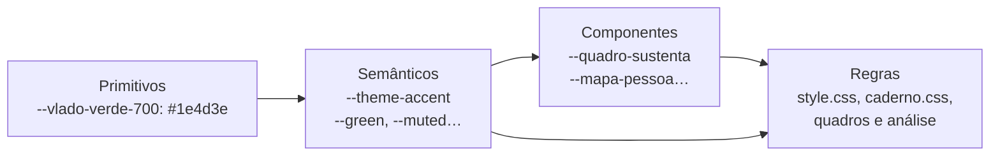

# Design system do Vlado

Onda 3: a referência visual do canvas "Vlado — Mesa ideal" está em [`referencia/`](referencia/README.md), a especificação por componente em [`componentes.md`](componentes.md) e as mudanças de token que o canvas traz, com o contraste medido, em [`mudancas-de-token.md`](mudancas-de-token.md). Até elas serem aplicadas, os valores desta página continuam valendo para o código.

A paleta atual da Mesa é a base. Esta fase não redesenha a interface: ela organiza os valores que já estavam em `interface/style.css` num arquivo só, `interface/tokens.css`, separado em três camadas. Só mudou o que falhava no contraste WCAG AA. O tema escuro já existia e continua com os mesmos nomes. Nenhum tema novo foi criado.

## Como as camadas se encaixam

| Camada | Prefixo | Onde | Regra |
|---|---|---|---|
| Primitivos | `--vlado-*` | `:root` de `tokens.css` | Único lugar com valor de cor (hexadecimal). Não muda por tema e nenhuma regra o usa direto. |
| Semânticos | `--theme-*`, apelidos curtos (`--paper`, `--ink`, `--muted`, `--green`…), escalas `--text-*`, `--espaco-*`, `--raio-*`, `--sombra-*` | `:root` (claro) e `:root[data-theme=dark]` (escuro) | Um conjunto por tema, com os mesmos nomes. Só referenciam primitivos. |
| Componentes | `--quadro-*`, `--tempo-*`, `--comparar-*`, `--tabela-*`, `--mapa-*`, `--pdf-*`, `--mesa-sidebar` | `:root` de `tokens.css` | O que um componente pinta. Só referenciam semânticos, que mudam com o tema. |

Ordem de carga: `tokens.css` → `style.css` → `caderno.css` em `index.html`. `entrar.html` e a página de convite antigo (servida por `scripts/interface_pesquisa.py`) também carregam `tokens.css` antes de `style.css`.

`testes/estilo_tokens.cjs` confere o contrato, e a suíte Python o executa por `testes/test_design_system.py`. Ele confere que:

- nenhuma regra em `style.css`, `caderno.css` e `entrar.css` tem hexadecimal, `rgb()`, `hsl()`, `white` ou `black`;
- nenhuma regra usa primitivo direto, e nenhum token de cor tem valor de reserva em `var()`;
- todo token usado está definido;
- os dois temas têm os mesmos nomes;
- os pares de texto e fundo passam de 4,5:1, e as bordas, o foco e as marcas do mapa passam de 3:1, nos dois temas;
- a escala de texto tem de 6 a 7 degraus, nunca abaixo de 12 px.

## Tokens semânticos de cor

| Token | Papel | Claro (primitivo · valor) | Escuro (primitivo · valor) |
|---|---|---|---|
| `--theme-background` | fundo da página | `papel-100` · `#f6f5f0` | `noite-900` · `#171d1a` |
| `--theme-surface` | cartões e painéis | `papel-50` · `#fffefa` | `noite-800` · `#202823` |
| `--theme-sidebar` | barra lateral | `papel-200` · `#efefe8` | `noite-950` · `#121714` |
| `--theme-text` | texto | `tinta-900` · `#202c29` | `papel-250` · `#eae9df` |
| `--theme-muted` | texto secundário | `tinta-600` · `#5f6a63` ⚠ | `tinta-300` · `#a8b3a9` |
| `--theme-accent` | verde do Vlado: ações, links | `verde-700` · `#1e4d3e` | `verde-300` · `#a8c79d` |
| `--theme-primary-hover` | botão principal ao passar | `verde-600` · `#2e604c` | `verde-200` · `#bad8af` |
| `--theme-on-primary` | texto sobre o verde | `branco` · `#ffffff` | `verde-950` · `#172315` |
| `--theme-line` | divisórias | `papel-300` · `#dddfd6` | `noite-700` · `#3c4940` |
| `--theme-input-line` | borda de campos | `tinta-500` · `#74837a` | `tinta-550` · `#64786a` |
| `--theme-accent-line` | borda verde | `verde-400` · `#7f9685` | `verde-350` · `#88a57f` |
| `--theme-focus` | anel de foco | `verde-500` · `#53886c` | `ocre-300` · `#e6bc7a` |
| `--theme-soft` | fundo verde claro | `verde-50` · `#e8eee6` | `verde-800` · `#2c3c2e` |
| `--theme-reading` | área de leitura | `papel-150` · `#f1f2e9` | `noite-750` · `#28322c` |
| `--theme-active` | item ativo | `verde-100` · `#e4e9dc` | `verde-800` · `#2c3c2e` |
| `--theme-warning` / `-bg` / `-line` | aviso | `terra-700` / `terra-50` / `terra-400` | `ocre-300` / `terra-900` / `terra-500` |
| `--theme-notice-line` | realce de notícia | `ocre-500` · `#b18442` | `ocre-300` · `#e6bc7a` |
| `--theme-danger` / `-bg` / `-line` | erro e remoção | `tijolo-700` / `tijolo-50` / `tijolo-400` | `tijolo-300` / `tijolo-900` / `tijolo-450` |
| `--theme-quote-line` | citação | `verde-450` · `#7e9972` | `verde-300` · `#a8c79d` |
| `--theme-selection` | texto selecionado | `verde-150` · `#cfe0cf` | `verde-550` · `#526b49` |
| `--theme-shadow` / `-soft` / `--theme-backdrop` | sombras e véu | `sombra-verde*`, `veu-verde` | `sombra-noite*`, `veu-noite` |
| `--theme-entidade-pessoa` | pessoa no mapa | `esmeralda-600` · `#1d8058` 🆕 | `esmeralda-400` · `#3fa877` 🆕 |
| `--theme-entidade-organizacao` | organização no mapa | `anil-600` · `#5b5fb8` 🆕 | `anil-400` · `#8487e6` 🆕 |

⚠ = valor ajustado. 🆕 = valor novo, criado para uma tela nova.

## Escalas

| Escala | Tokens | Valores |
|---|---|---|
| Texto (já existia) | `--text-xs … --text-2xl`, mais `--text-quote` e `--text-brand` | 12, 13, 14, 16, 18, 22, 28 px; citação 20 px; marca 36 px |
| Espaço (base 4 px) | `--espaco-1 … --espaco-8` | 4, 8, 12, 16, 20, 24, 32 px |
| Raio | `--raio-controle`, `--raio-cartao`, `--raio-painel`, `--raio-pilula` | 6, 8, 10, 999 px |
| Sombra | `--sombra-cartao`, `--sombra-flutuante` | `0 1px 2px` e `0 4px 18px` com `--theme-shadow-soft` |

As escalas de espaço, raio e sombra vêm dos valores que mais aparecem em `style.css`: raios de 6, 8 e 10 px e espaçamentos múltiplos de 4. As regras antigas continuam com os valores medidos, porque trocá-las todas mudaria o desenho nos casos de borda (raios de 5 e 9 px, por exemplo) e fugiria de "não mudar o visual". As telas novas usam só as escalas.

## Tokens de componente

| Componente | Tokens | Aponta para |
|---|---|---|
| Quadro de hipóteses | `--quadro-sustenta`, `--quadro-contraria`, `--quadro-falta`, `--quadro-indisponivel`, `--quadro-fundo`, `--quadro-coluna-fundo`, `--quadro-borda`, `--quadro-raio` | accent, danger, warning, muted, surface, reading, line, `--raio-painel` |
| Linha do tempo | `--tempo-trilho`, `--tempo-marco-exato`, `--tempo-marco-parcial` | accent-line, accent, surface (marco vazado) |
| Comparador | `--comparar-removido-fundo/-texto`, `--comparar-incluido-fundo/-texto` | danger-bg/danger, soft/accent |
| Tabela conferível | `--tabela-corrigida`, `--tabela-pendente`, `--tabela-foco` | warning-line, input-line, active |
| Mapa de relações | `--mapa-pessoa`, `--mapa-organizacao`, `--mapa-ligacao`, `--mapa-ligacao-destaque`, `--mapa-rotulo-fundo` | entidade-pessoa, entidade-organizacao, muted, focus, surface |
| Leitor de PDF | `--pdf-pagina`, `--pdf-selecao`, `--pdf-trecho`, `--pdf-trecho-borda` | primitivos `branco` e `pdf-*` (a página impressa é branca nos dois temas) |

## Ajustes e a razão de cada um

| Ajuste | Antes | Depois | Razão |
|---|---|---|---|
| `--theme-muted` (claro) | `#626d66` | `#5f6a63` | Sobre `--theme-active` (`#e4e9dc`, item ativo) dava 4,36:1, abaixo dos 4,5:1 do WCAG AA para texto. Passa a 4,56:1, com a menor mudança que resolve. Os outros pares do texto secundário continuam acima de 4,5:1. |
| Leitor de PDF | `background:white`, `rgb(0 90 200 / .3)`, `rgb(255 196 0 / .42)`, `rgb(196 120 0 / .55)` | `--pdf-pagina`, `--pdf-selecao`, `--pdf-trecho`, `--pdf-trecho-borda` | Eram as únicas cores literais fora dos tokens. Os valores são os mesmos, em hexadecimal com alfa. |
| Reserva em `var()` | `var(--line, rgba(127,127,127,.25))` e `var(--white, var(--theme-surface))` | `var(--line)` e `var(--white)` | Os dois tokens sempre existem. Uma reserva esconderia um token que faltasse. |
| Cores do mapa | — | esmeralda e anil (claro `#1d8058`/`#5b5fb8`, escuro `#3fa877`/`#8487e6`) | O mapa precisa de duas cores categóricas, para pessoa e organização. O verde do Vlado (`#1e4d3e`) fica abaixo do piso de croma e lê como cinza no gráfico, e as cores de aviso e erro são reservadas para estado. O par passou nas checagens da skill `dataviz` no claro e no escuro: faixa de luminosidade, croma, separação para daltonismo (ΔE 17), visão normal (ΔE 21) e contraste de pelo menos 3:1 sobre a superfície. A cor nunca é o único sinal: pessoa é círculo, organização é quadrado, e cada nó tem rótulo. |

| `--mapa-ligacao` | `--theme-input-line` | `--theme-muted` | A captura com foco de teclado (`qa_quadros`) levou a medir as linhas contra o fundo do próprio mapa (`--quadro-coluna-fundo`). No escuro, `#64786a` sobre `#28322c` dava 2,80:1, abaixo dos 3:1 do WCAG 1.4.11 para elementos gráficos. Com `--theme-muted`, fica 6,1:1 no escuro e 5,0:1 no claro. A linha em foco (`--theme-focus`) dá 7,5:1 e 3,7:1, e se distingue também pela largura (4 px mais um halo de 14 px). |

Os pares que já passavam ficaram como estavam:

| Par | Claro | Escuro |
|---|---|---|
| texto sobre página | 13,2:1 | 14,0:1 |
| texto secundário sobre página | 5,2:1 (era 4,9:1) | 7,9:1 |
| verde sobre superfície | 9,5:1 | 8,2:1 |
| aviso sobre fundo de aviso | 5,7:1 | 7,5:1 |
| erro sobre fundo de erro | 7,0:1 | 6,7:1 |

## Consultas às skills

Foram consultadas as skills `design-system` (arquitetura em três camadas, `references/token-architecture.md`), `ui-ux-pro-max` e `dataviz`. As consultas a `ui-ux-pro-max/scripts/search.py`:

| Consulta | O que foi aproveitado | O que foi descartado |
|---|---|---|
| `"editorial analytics dashboard investigative journalism" --design-system` | Estilo "data-dense dashboard": foco visível, contraste de 4,5:1, respeito a `prefers-reduced-motion` e teste em 375, 768, 1024 e 1440 px. | A paleta azul e âmbar e as fontes Fira carregadas do Google Fonts. A paleta do Vlado é a base, e fontes da internet são proibidas nesta fase. |
| `"network graph relationship accessible" --domain chart` | Até 100 nós em SVG. Tipos de nó por forma e rótulo, não só pela cor. A lista de adjacência é a fonte acessível. O foco mostra o detalhe do nó, e há botões no lugar de arrastar. | Bibliotecas como D3 e Cytoscape: o mapa é SVG sem biblioteca. |
| `"timeline chronological events" --domain chart` | Estilo de traço (sólido ou tracejado) e rótulo direto, nunca só a cor, com a lista sempre visível. | Gráfico de linha: a linha do tempo é uma lista vertical de eventos, não uma série numérica. |
| `"color not only indicator" --domain ux` | Cada estado leva texto ou ícone além da cor: suporte, contradição, lacuna, célula corrigida, data parcial. | — |
| `"data table keyboard focus" --domain ux` | Anel de foco visível em todas as células focáveis, e foco nunca coberto pelo cabeçalho fixo (o `scroll-padding-top` já existia). | — |

## Para quem cria telas novas

- Use `--quadro-*`, `--mapa-*` e os semânticos. Nunca escreva uma cor nem use `--vlado-*` numa regra: o teste falha.
- Um token novo de componente aponta para um semântico. Uma cor nova entra primeiro como primitivo, com par claro e escuro. Se for categórica, passa pelo validador da skill `dataviz`.
- Estado nunca só por cor: acrescente texto, forma ou traço.
- Fontes, scripts e estilos vêm só da própria Mesa, sem CDN.
